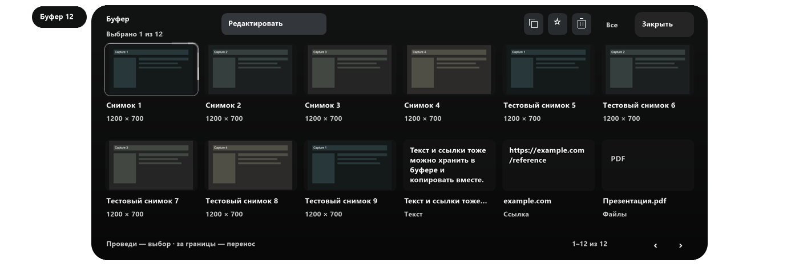

<h1>Top Island</h1>

Музыка, файлы и быстрые действия — в компактном островке поверх Windows.

[Скачать 2.2.0 · тестовая сборка](https://github.com/Borantiy/TopIsland/releases/tag/v2.2.0) · [Все выпуски](https://github.com/Borantiy/TopIsland/releases) · [Сообщить о проблеме](https://github.com/Borantiy/TopIsland/issues)

## Всё рядом

- **Музыка:** обложка, живой индикатор, управление воспроизведением и Discord Rich Presence.
- **Буфер:** файлы, картинки, текст и ссылки. Выделение проведением, общие действия и перенос группы.
- **Снимки:** небольшое уведомление в островке и редактор для одного изображения.
- **Фокусировка:** таймер сессии и приглушение уведомлений островка.
- **Заметки:** быстрый текст и диктовка по действию пользователя.
- **Оформление:** семь материалов, два собственных видеофона и размер 80–140%. Отдельное оформление буфера.

## Запуск

1. Открой [выпуск 2.2.0](https://github.com/Borantiy/TopIsland/releases/tag/v2.2.0) и скачай `TopIsland-2.2.0-windows-x64.zip`.
2. Распакуй папку и запусти `TopIsland.exe`. Права администратора не нужны.
3. Открой центр приложения через островок или значок в трее.

Windows x64 и Microsoft Edge WebView2 Runtime. Этот выпуск проверен на Windows 11; отдельная проверка Windows 10 не выполнена. Настройки и заметки сохраняются в профиле Windows, отдельно от файла программы.

## Статус выпуска

**2.2.0 — публичный prerelease.** Его интерфейс и возможности объединены из приватных тестовых сборок. Он не заменяет стабильный выпуск автоматически.

EXE пока **без цифровой подписи**. Для 2.1.0 ранее было срабатывание Касперского; снятие этого детекта для новой версии не подтверждено, достоверный результат локального антивирусного сканирования не получен. Если защита блокирует запуск, не отключай её и не добавляй исключение ради приложения. Подробности и SHA-256 приложены к [релизу](https://github.com/Borantiy/TopIsland/releases/tag/v2.2.0).

Фоны из Pinterest остаются приватными референсами и не входят в публичный пакет. Исходный код закрыт; этот репозиторий содержит описание, изображения и файлы выпусков.
