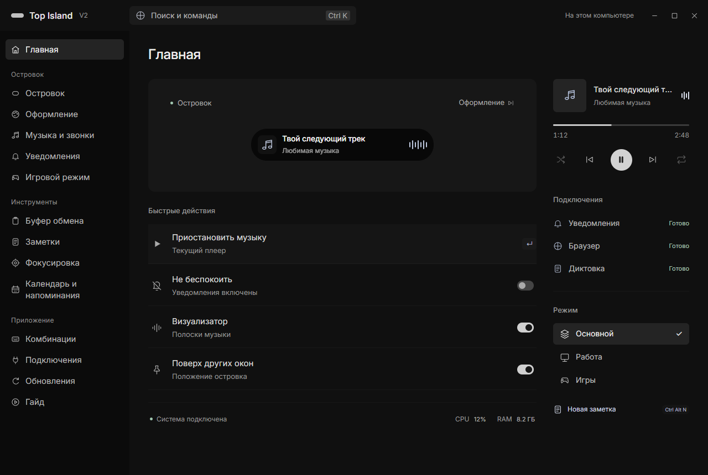
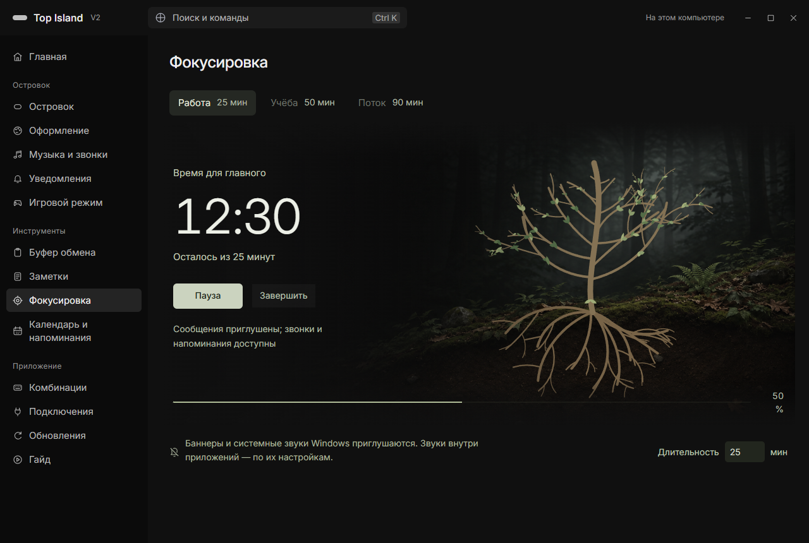
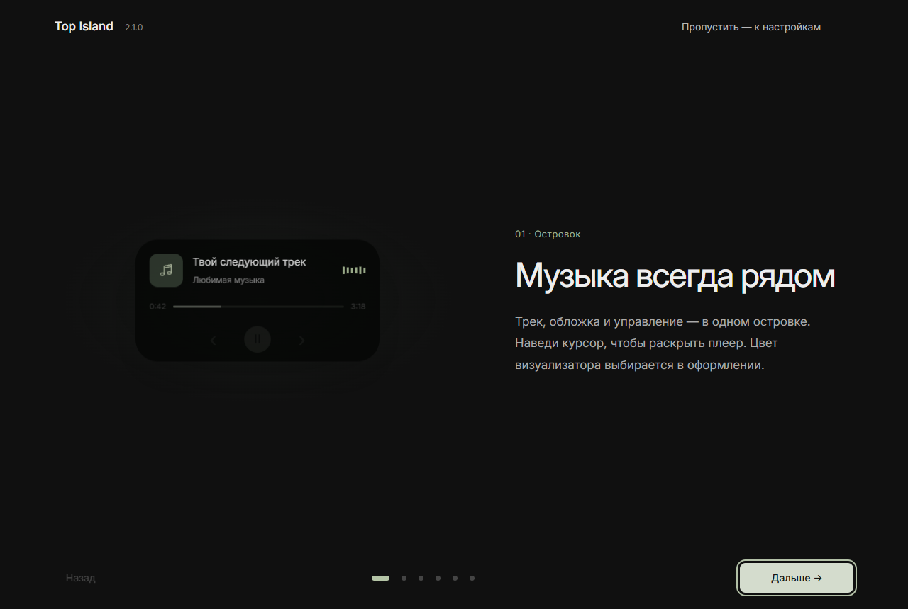

# Top Island

### Музыка, сообщения и время — в одном островке.

Компактный помощник для Windows с тёмным интерфейсом, фокусировкой и голосовыми заметками.

**[Скачать для Windows](https://github.com/Borantiy/TopIsland/releases/latest)** · [Что нового](CHANGELOG.md) · [Сообщить об ошибке](https://github.com/Borantiy/TopIsland/issues/new/choose)

## Всё нужное рядом

| Возможность | Что делает |
| --- | --- |
| **Музыка** | Обложка, трек, управление воспроизведением и визуализатор рядом с рабочим столом. |
| **Уведомления и звонки** | Сообщения в островке, входящие звонки и управление микрофоном Discord при доступном состоянии клиента. |
| **Фокусировка** | Таймер с паузой, растущее дерево и корни. Приглушение обычных уведомлений и системных звуков Windows. |
| **Заметки и диктовка** | Запись мыслей текстом или голосом; распознавание выполняется локально. |
| **Игровой режим** | CPU и память поверх игры, выбор положения и прозрачности HUD. |
| **Быстрые инструменты** | История буфера обмена, напоминания, поиск команд и сочетания клавиш. |
| **Оформление** | Тёмные поверхности, собственный акцент, настройки островка и уменьшение движения. |

## Время для главного

Во время сессии островок становится таймером. Дерево и корни растут вместе с прогрессом; важные звонки и напоминания остаются доступны.

## Установка

1. Открой [последний стабильный выпуск](https://github.com/Borantiy/TopIsland/releases/latest).
2. Скачай `TopIsland-…-windows-x64.zip` и распакуй в отдельную папку.
3. Запусти `TopIsland.exe`. Первый запуск новой версии откроет короткий гайд.
4. В разделе **Подключения** разреши нужные интеграции. Для браузерного плеера подключи Top Island Bridge по инструкции приложения.

**Обновление:** центр → Обновления → обновить и перезапустить. Настройки и заметки хранятся отдельно в профиле Windows.

Нужны **Windows 10/11 x64** и [Microsoft Edge WebView2 Runtime](https://developer.microsoft.com/microsoft-edge/webview2/). Сборка проверяется на Windows 11; отдельная живая проверка Windows 10 пока не завершена. EXE пока без цифровой подписи издателя.

Короткий гайд внутри приложения

Шесть страниц показывают музыку, уведомления, фокусировку, игровой HUD, диктовку и инструменты. Гайд можно пропустить или открыть повторно в разделе «Гайд».

## Подключения и ограничения

- Плееры передают разный объём данных: точность трека, обложки и таймлайна зависит от источника. Браузерное расширение добавляет данные вкладки.
- Firefox использует временную установку расширения до перезапуска браузера.
- Фокусировка приглушает системные звуки Windows. Звуки, которые проигрывают сами приложения, регулируются в этих приложениях.
- Некоторые сочетания клавиш могут быть заняты другими программами. Их можно переназначить.
- Нагрузка фоновых служб ещё требует оптимизации.

**В разработке:** музыкальный статус Discord Rich Presence. Он готовится отдельно от стабильной 2.1.0; для проверки требуется зарегистрированный Discord Application ID.

## Выпуски и обратная связь

[Стабильные и тестовые сборки](https://github.com/Borantiy/TopIsland/releases) · [История изменений](CHANGELOG.md) · [Предложить функцию](https://github.com/Borantiy/TopIsland/issues/new/choose)

При ошибке укажи версию Top Island и Windows, плеер или браузер и шаги воспроизведения. Удали личные сообщения, пути с персональными данными и секреты со скриншотов и из логов.

Этот репозиторий содержит **готовые выпуски и документацию**. Исходный код приложения закрыт. Скриншоты показывают интерфейс с демонстрационными данными.
